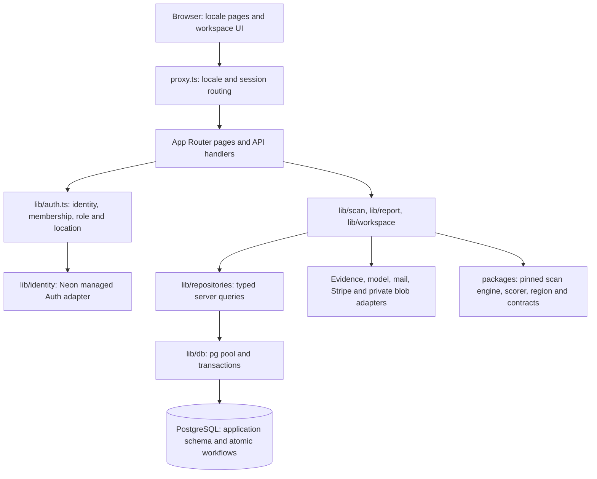

# Kinnso OS architecture

This is the merchant app in `YNWAforever/smeassistant` (historical repository name).
It is a Next.js 16 App Router application with React 19 and TypeScript, deployed
as a server application. Start with [development and verification](docs/DEVELOPMENT.md)
for commands. [CLAUDE.md](CLAUDE.md) owns product guardrails; its dated amendments
and current Neon operating contract supersede its historical prototype playbook.

## Runtime boundaries

| Boundary | Implementation and rule |
|---|---|
| UI and locale | `app/[locale]/`, `components/`, `lib/copy*.ts`; en, zh-HK and zh-TW. Locale selects language; the stored HK/TW market selects currency and business rules. Demo records stay on demo surfaces. |
| Identity | `lib/identity/composition.ts`, `lib/identity/neon.ts`, `lib/identity/users.ts`; managed provider subjects map to application UUIDs. Sessions are checked upstream for revocation. The pinned Auth SDK is not a browser database client. |
| Authorization | `lib/auth.ts`, `lib/workspace/authorize-workspace.ts`; accepted membership, role and location scope come from the server. Staff allowlists alone do not grant merchant access. Dependency outages remain distinct from signed-out or forbidden decisions. |
| Persistence | `lib/repositories/`, `lib/db/schema/`, `lib/db/client.ts`; repositories use `pg` and Drizzle on the server. The runtime login inherits restricted `sme_app_runtime` grants/RLS; application checks still enforce tenant access. Browsers receive neither database credentials nor migration authority. |
| Atomic workflows | `lib/repositories/workflow.ts`, `lib/db/transaction.ts`, `neon/migrations/`; SQL owns version transitions, audit records, delivery deduplication and usage accounting. Completion context must use the same transaction client. |
| Provider effects | `lib/scan/`, `lib/agents/`, `lib/mail/`, `lib/stripe.ts`, `lib/storage/private-blob.ts`; budgets, explicit gates and adapter contracts bound external effects. Private evidence access requires authorization. |
| Pinned contracts | `packages/*/VENDOR.md`; upstream provenance and intentional adaptations are recorded there. Scoring versions determine whether scans can be compared. |

`proxy.ts` is routing/session plumbing; each sensitive handler must still authorize
its entity. Version mutations share `app/api/actions/_shared/mutation.ts`: validate
the ID, resolve persisted scope, authorize manager/owner access, recheck the action
and snapshot, then consume a rate-limit token before invoking a workflow.

## Core flows and executable evidence

| Flow | Durable behavior | Tests to start with |
|---|---|---|
| Public scan → report | `app/api/scan/start` validates identity/consent, admits work and dispatches `lib/scan/run.ts`. The scan engine persists evidence/results; report loaders sanitize the public view and enforce viewer/member access. Unavailable evidence lowers coverage, never invents a zero score. | `app/api/scan/start/route.test.ts`, `lib/scan/run.test.ts`, `test/integration/neon-scan-start.integration.test.ts`, `test/integration/neon-private-content.integration.test.ts` |
| Draft → edit → approve → export | A saved edit creates a new immutable version. Approval names one version. First approved export/copy counts once; generation, approval alone and same-version retries do not consume another delivery. Stale bases conflict. | `app/api/actions/[actionId]/versions/route.test.ts`, `app/api/versions/[versionId]/versions.test.ts`, `test/integration/neon-artifact-runtime.integration.test.ts` |
| Unsaved preview | `app/api/start/[slug]/preview` authorizes a report grant and claims a bounded preview slot. It returns draft text without creating an action/output version. Preview events record outcome/cost, without retaining draft text. | `app/api/start/[slug]/preview/route.test.ts`, `test/integration/neon-preview-events.integration.test.ts` |
| Scan completion → action/measurement | `lib/workspace/completion.ts` uses a completion ledger and lease fencing; `lib/workspace/post-process.ts` derives owner work. A completed engine job alone does not prove workspace completion. | `lib/workspace/completion.test.ts`, `test/integration/neon-completion.integration.test.ts` |
| Stripe → entitlement | The signed webhook rereads the current subscription before updating tier, so old/out-of-order events cannot dictate entitlement. Processing failures return non-2xx for retry. | `app/api/webhooks/stripe/route.test.ts`, `test/integration/neon-integrations.integration.test.ts` |

These paths are entry points, not a claim of complete coverage. Route tests use
repository fakes; SQL tests prove actual locking, grants, uniqueness and rollback.
`e2e/acceptance/` joins browser, local identity, SQL and fixture providers.

## Failure and recovery contracts

- Version mutations return 400 for malformed IDs, 404 for absent entities,
  401/403 for authentication/authorization refusal, 409 for workflow conflicts,
  429 for rate limits and 503 for recognized dependency failures. Refused
  authorization must not consume a mutation token or execute a workflow.
- An export may commit before its usage read or HTTP response fails. Retry the
  same exact version/mode with the same `idempotency_key`; the atomic workflow
  returns the existing delivery. A 503 does not establish that no write happened.
- External review-reply publishing is a separate, default-off flow governed by
  `GBP_REPLY_PUBLISH_ENABLED`, explicit approval, provider read-back and reconciliation.
  An uncertain remote result needs reconciliation before retrying a write.
- Both client and scheduled runtime paths currently resolve to Vercel; external
  Cloudflare dispatch is blocked (`lib/scan/dispatch-runtime.ts`). `vercel.json` registers
  no cron. Source code for a callback is not evidence that a worker is deployed.
- Applied migrations are immutable; append the next migration. After accepting
  writes, recover with a verified compatible build on the same database or a
  reviewed forward fix. Follow [NEON-CUTOVER.md](docs/integration/NEON-CUTOVER.md)
  for data-preserving recovery and hosted acceptance.

## Short risk map

| Risk | Impact | Existing defense / remaining evidence gap |
|---|---|---|
| Tenant or revoked-session access | High: private merchant content or unauthorized edits | Server scope/membership checks, SQL grants and outage regressions; real managed Auth revocation/delivery acceptance still needs a selected isolated target. |
| Retry and concurrency boundaries | High: duplicate delivery, usage or stale approval | Atomic SQL workflows, idempotency keys and integration races; callers must retain retry keys after ambiguous responses. |
| Hosted configuration/schema drift | High: runtime failure or unsafe recovery | Checksummed migrations, readiness and fixture recovery; historical owner reports do not establish current hosted journal/configuration. |
| Provider spend or uncertain side effects | High: cost, duplicate remote action or misleading evidence | Admission budgets, usage accounting, flags, reconciliation and public-evidence limitations; live provider acceptance is separate from fixture success. |
| Verification/documentation drift | Medium: green local checks mistaken for release proof | CI and owned fixtures; keep current entry-point docs separate from historical phase reports and attribute results to exact commits. |

## Next three engineering investments

1. **Close isolated hosted acceptance.** Select the Neon/Auth/Vercel target and
   authorized accounts, then record exact build, journal and callback identities.
   Exit when real sign-in, revocation, tenant denial and data-preserving recovery
   pass the existing hosted checklist with sanitized evidence.
2. **Make ambiguous effects observable.** Join request, run, delivery, completion
   and provider-attempt IDs in operational views; surface stalled/uncertain work
   and retry guidance. Exit when an operator can reconcile a lost export response
   and interrupted scan without replaying paid collection or double counting.
3. **Maintain a small behavioral release suite.** Keep browser → API → SQL tests
   for scan/report privacy and draft/edit/approval/export, including denial,
   concurrency and post-commit response failure. Add mutation checks for those
   boundaries and publish timings so the suite stays practical on every PR.
